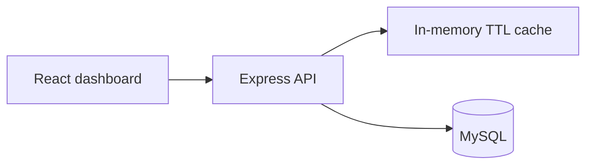

# Workshop Operations Dashboard

A web dashboard that reads operational data from MySQL through a small Express API and presents it in a React interface.

> Public source edition. Configure credentials locally and use empty or synthetic inputs. Company and institution names identify the original integration context; this repository does not claim affiliation or endorsement.

## Components

- **Frontend:** React, TypeScript, and Vite.
- **API:** Express and TypeScript.
- **Data:** MySQL through `mysql2`.
- **Runtime:** Dockerfile and environment-based configuration.

## Data flow

## Local development

Requires Node.js 20 or later and access to a compatible MySQL database. Copy `.env.example` to `.env`, set the database variables using authorized local values, then run `npm ci` and `npm run dev`. The client and API run as separate processes.

For a container build, use `docker build -t workshop-dashboard .` and provide the required environment variables at runtime. The server listens on `PORT` (default `3001`).

## Configuration

The example file documents the `VITE_*`, `PORT`, cache timing, and `DB_*` settings. It contains placeholders only. Keep the database service account read-only where possible and never commit `.env`.

## Repository note

Generated `node_modules/` and `dist/` content was tracked in the original repository. The source of truth is the application source and lockfile; generated dependencies and build output are excluded from the curated version.
